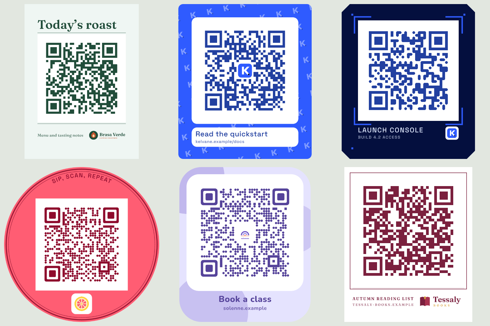

# QR Studio

[](https://github.com/malclement/QRforge/actions/workflows/ci.yml)
[](LICENSE)

A local-first design studio for branded QR codes. Enter a URL or text, add a
logo, pick one of six generated designs, refine it, and export SVG or PNG. Every
export is decoded by two independent decoders before it is offered, and the
check is bound to the exact bytes you download.

Everything except the optional Claude assistant runs in your browser, with no
account, API key or internet connection.



## Setup

Requires Node 24 or newer (developed on 26.8.1) and npm 11.

```sh
npm ci
npm run dev            # http://127.0.0.1:5173
```

| Command | What it does |
| --- | --- |
| `npm run dev` | App only. All core features. |
| `npm run dev:ai` | App plus the optional Claude Code bridge. |
| `npm run bridge` | The bridge alone (prints a pairing code). |
| `npm run build` / `npm run preview` | Static production build, served on `:4173`. |
| `npm run typecheck` / `npm run lint` | Strict TypeScript and ESLint. |
| `npm test` | Unit and integration tests (Vitest). No network, no AI. |
| `npm run test:e2e` | Browser tests (Playwright) against the production build. Run `npx playwright install chromium` once. |
| `npm run samples` | Rebuild the example projects and logos from `scripts/sample-brands.ts`. |
| `npm run smoke:claude` | One real request through your Claude Code login. Never run by the other commands. |

## Using it

1. **Content.** Type the URL or text. The panel shows the exact bytes that will
   be encoded. Nothing is trimmed, shortened or rewritten; fixes such as "Trim
   whitespace" are buttons you choose to press.
2. **Logo and brand.** Drop a PNG, JPEG, WebP or static SVG. Colours are
   extracted from its pixels and assigned to roles (modules, symbol background,
   accent, support). Each choice is explained and editable.
3. **Direction.** Pick style attributes and a caption, then generate. You get
   six designs, one per family: Precision, Soft, Editorial, Technical, Emblem,
   Pattern. They differ in layout and module geometry, not only colour.
4. **Refine.** The Design tab edits the selected variation. Undo/redo covers
   every change (`⌘Z`, `⇧⌘Z`). Projects save automatically in the browser.
5. **Verify.** The Verify tab shows what was measured and offers fixes
   ("Shrink logo", "Increase contrast", "Simplify modules", "Restore spacing",
   or a search that tests combinations).
6. **Export.** PNG, SVG, the validation report as JSON, and the project as a
   portable `.qrstudio.json` file including its logo.

Six finished examples for fictional brands are under Projects → Examples.

## What "verified" means

- **Baseline** (required for a normal export): jsQR and ZXing-C++ must both
  return the exact payload bytes from the PNG that will be downloaded, and from
  the exported SVG rasterized at 512 and 1024 px.
- **Stress profile** (`qrstudio-stress` v1, reported separately): ten fixed
  transformations (half and one-third resolution, low-contrast grayscale, blur,
  blur after downscaling, 12° rotation, JPEG quality 35, perspective, seeded
  noise, dark surroundings), each with both decoders. Results are counts, such
  as "18 of 20 simulated checks passed".
- Any edit changes the configuration fingerprint, so earlier results stop
  applying immediately. A report carries the fingerprint, SHA-256 of the exported
  PNG and SVG, decoder versions and rasterization details.

These are software checks under simulated conditions. They do not certify any
phone, printer, material or lighting. See the checklist below.

## Optional: suggestions from Claude

The assistant proposes style recipes. It never receives the QR content or the
logo image; the brief contains the palette, logo proportions, style attributes
and your description. Requests go to Anthropic through your own Claude Code
installation, so this part needs a network connection and uses your plan.

- **Manual hand-off (always available).** Assistant → *Export design brief*,
  give the file to Claude Code yourself, paste the JSON reply into *Import
  design recipe*.
- **Local bridge.** `npm run bridge` (or `npm run dev:ai`), then open the
  printed link or paste the pairing code. Press *Ask Claude for designs* to make
  one request. Nothing is sent while you edit.

Either way the reply is validated against a strict schema, rendered by the same
renderer and verified like any other design.

Bridge requirements and behaviour:

- Claude Code 2.1.330 or a version offering the same flags, signed in with a
  Claude subscription (`claude` → sign in). The bridge checks this with
  `claude auth status` and refuses API-key or cloud-provider authentication. It
  does not pass `ANTHROPIC_API_KEY` or similar variables to the CLI.
- It listens on `127.0.0.1` only, accepts only the app's own origin, and needs
  the per-session pairing code.
- The CLI runs with `--safe-mode`, no tools, no MCP servers and denied
  permission prompts, in an empty temporary directory. These are CLI flags, not
  an operating-system sandbox.
- Environment: `QRSTUDIO_BRIDGE_PORT` (4317), `QRSTUDIO_ALLOWED_ORIGINS`,
  `QRSTUDIO_CLAUDE_BIN`, `QRSTUDIO_CLAUDE_MODEL`.

The bridge is for one person on their own computer. Do not host it for others:
Anthropic's terms do not allow routing other people's requests through a
subscription login.

## Export limits

- SVG holds the symbol, frame and captions as vector paths with no external
  fonts or images. A raster logo stays a raster image inside it. An SVG logo is
  embedded as a nested SVG image, which some design tools rasterize or drop;
  export PNG for those.
- PNG width is 128–4096 px. By default the width snaps to a whole number of
  pixels per module.
- Captions use five bundled fonts covering Latin and Latin Extended. Other
  characters are reported and skipped, not substituted.
- SVG logos must be static: no scripts, event handlers, `foreignObject`,
  external references, embedded images, animation or live text.
- Projects live in this browser's IndexedDB. Export the project file to back up
  or move one.

## Before you print or publish: scan checklist

Status of these checks for this release: **pending**. No physical device or
print test has been performed; only the software checks above.

- [ ] iPhone camera app, at the intended distance
- [ ] Android camera app (and Google Lens), at the intended distance
- [ ] An older or budget phone
- [ ] On screen at final size, and at half that size
- [ ] Printed proof at final size on the real material (matte and glossy differ)
- [ ] Printed proof in dim light and under glare
- [ ] At an angle of roughly 30°, and from the farthest expected distance
- [ ] The decoded text matches the intended content exactly

## Architecture

```
src/core        Pure TypeScript, no React, storage or AI
  content/        payload analysis; nothing is rewritten
  qr/             encoder adapter, function-module map, codeword geometry
  brand/          asset limits and sniffing, SVG sanitizer, palette extraction
  recipe/         DesignRecipe schema, six preset families, variation generator
  render/         deterministic SVG renderer, compositions, logo placement, fonts
  verify/         raster transforms, decoders, stress profile, reports, repair
  project/        versioned project schemas, migrations, defaults
src/state       editor store, undo history, verification session
src/platform    browser-only: canvas rasterizer, worker, IndexedDB, fonts
src/ai          brief, prompt, suggestion validation, bridge client
src/ui          React components
bridge/         optional Node service around the Claude Code CLI
```

Decisions and their reasons are in [docs/architecture.md](docs/architecture.md).
Licences of bundled code and fonts are in
[THIRD_PARTY_NOTICES.md](THIRD_PARTY_NOTICES.md).

## Later

Wi-Fi and vCard helpers, PDF export, batch generation from CSV, a dedicated
image-generation provider for illustrated codes, dynamic redirects and
analytics, accounts and collaboration.

## Contributing

See [CONTRIBUTING.md](CONTRIBUTING.md). Report vulnerabilities privately, as
described in [SECURITY.md](SECURITY.md).

## Licence

[MIT](LICENSE). Bundled third-party code and fonts keep their own licences,
listed in [THIRD_PARTY_NOTICES.md](THIRD_PARTY_NOTICES.md).
